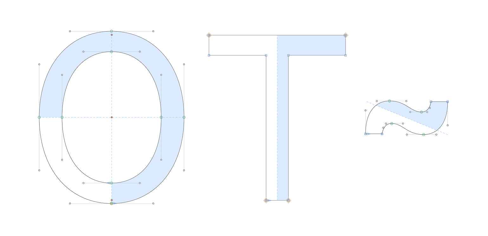
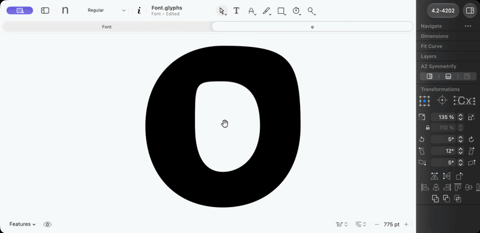
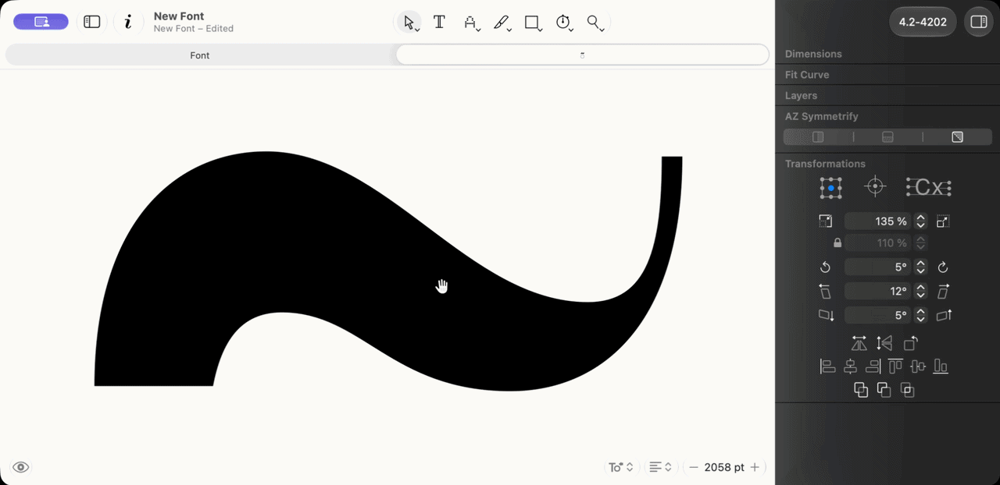
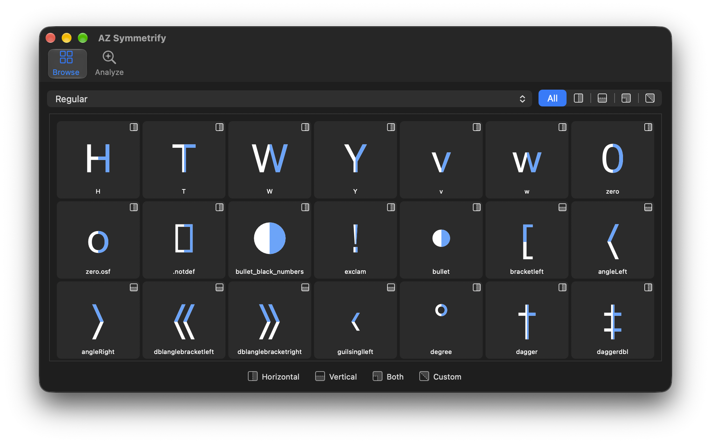

  

<h1 align="center">AZ Symmetrify</h1>

  <strong>Draw one half. The other half follows.</strong>

  <a><picture>
    <source media="(prefers-color-scheme: dark)" srcset="https://img.shields.io/badge/Free_Plugin-6690e3">
    
  </picture></a>
  <a href="https://azerty-typefaces.com"><picture>
    <source media="(prefers-color-scheme: dark)" srcset="https://img.shields.io/badge/More_AZ_plugins-242424">
    
  </picture></a>

---

   

AZ Symmetrify is [GlyphsApp](https://glyphsapp.com/) to keeps a glyph symmetric while you draw. Flip a switch in the palette and the axis places itself through the centre of the shape. From then on you draw one half and the other is rebuilt from it as you go.

 

## Getting started

1. Install AZ Symmetrify with the link for your Glyphs version:
   - **Glyphs 3:** [Install in Glyphs 3](https://azerty-typefaces.github.io/AZ-Symmetrify/install.html?v=3)
   - **Glyphs 4:** [Install in Glyphs 4](https://azerty-typefaces.github.io/AZ-Symmetrify/install.html?v=4)

   Or open *Window ▸ Plugin Manager*, find **AZ Symmetrify** and click *Install*.
2. Restart Glyphs.

 

## Horizontal/Vertical Symmetry

  

**Mirror Horizontal** flips left over right, across a vertical axis: `A H T V x`. **Mirror Vertical** flips top over bottom, across a horizontal axis: `B E H`. Turn both on and one corner drives all four.

Your selection decides which half you keep: the side that holds the selected nodes. With nothing selected it is the left half, or the bottom one. Hover a switch to read which way it will go, for example `Mirror Horizontal (Left → Right)`.

## Custom Symmetry Axis 

  

**Custom** pairs nodes diagonally opposite, a half-turn about the centre, and italics whose two sides curve the same way.

It keeps one side of a line through the centre, set in the palette's **Diagonal** field in degrees, as Glyphs measures a guide's (0 along x, 90 upright). Empty is **Auto**: the line runs corner to corner across the glyph's bounding box, and the field shows that angle in grey. Type a number to choose your own.

| Key | Does |
| --- | --- |
| `↑` `↓` | Changes the angle by 1° |
| `⇧↑` `⇧↓` | Changes it by 10° |
| `Return` | Applies the angle and turns Custom on |

The glyph previews the new split while you type. Typing an angle is the instruction to reshape, so the switch stays clickable however far the half you keep would move, as long as every node pairs. Its tooltip says how far. The angle applies to that glyph in every master, until you close the document. 

 

## Several Symmetries on One Glyph

Select whole paths, then click a switch: the symmetry covers only those paths, about the centre of their own box. A glyph can carry several this way, like the `S` of a `$` turned with **Custom** and its bar mirrored left to right.

Each symmetry shows its generated half in blue. Select its paths, or any node in them, to see its dashed axis, light its switches, and switch it off. A path belongs to one symmetry at a time.

 

## Browse and Analyze

Open *Window ▸ AZ Toolkit ▸ Symmetrify*.

   

- **Browse** shows every layer that carries a symmetry, with its generated half in blue. Filter by master and by symmetry, and double-click a cell to go to it.
- **Analyze** measures every master of the font and lists the glyphs that could take a symmetry without binding reshaping them, with a bar for how much room is left. Tick rows and press **Apply** to bind every master of those glyphs. Nothing changes until you do.

## Feedback

Bugs and ideas go to the [issue tracker](https://github.com/azerty-typefaces/AZ-Symmetrify/issues).

## Credits

Copyright © 2026 [Hugo Jourdan](https://azerty-typefaces.com). All rights reserved.

Made possible with the GlyphsSDK by Georg Seifert (@schriftgestalt) and Rainer Erich Scheichelbauer (@mekkablue).
